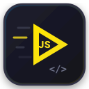
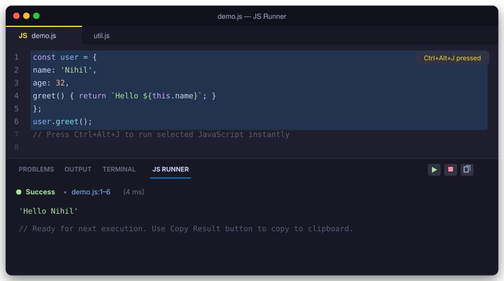
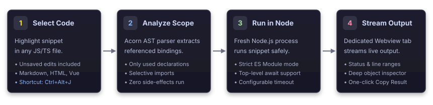

<div align="center">



# JS Runner

**Run selected JavaScript instantly in a dedicated VS Code bottom panel**

*Zero-config scratchpad execution, smart AST dependency closure extraction, and live streaming output.*

<p>
  <a href="LICENSE"></a>
  
  
  
  
</p>

---

<p>
  <a href="#-about-js-runner">About</a> •
  <a href="#-key-features">Key Features</a> •
  <a href="#-visual-tour--workflow">Visual Tour</a> •
  <a href="#-installation--quickstart">Installation</a> •
  <a href="#-how-to-use">How to Use</a> •
  <a href="#%EF%B8%8F-configuration--settings">Settings</a> •
  <a href="#-execution-model--architecture">Architecture</a> •
  <a href="#-development--testing">Development</a> •
  <a href="#-license">License</a>
</p>

<p align="center">
  
</p>

</div>

---

## ⚡ About JS Runner

**JS Runner** turns your editor into an instant JavaScript playground. Instead of opening external terminals, switching between browser consoles, or creating throwaway scratch files, simply highlight any snippet of code and hit **`Ctrl+Alt+J`** (`Cmd+Alt+J` on macOS).

JS Runner evaluates your code in a dedicated bottom tab nestled alongside **Terminal**, **Output**, and **Ports**. It automatically inspects your file's AST, pulling in only the variables, functions, and module imports that your selection needs—without executing unrelated statements or side effects.

- 🎯 **Focused Scratchpad**: Run partial logic without running the entire script or project.
- 🧠 **Smart Context Resolution**: Referenced declarations and imports are extracted automatically from the unsaved editor buffer.
- 🚀 **Zero-Config Execution**: Evaluated in fresh Node.js processes with modern ES module semantics and top-level `await`.
- 📺 **Non-Intrusive Panel**: Live output streams to an integrated Webview panel with colored statuses and deep object inspection.

---

## ✨ Key Features

<table width="100%">
  <tr>
    <td width="50%">
      <h3>⚡ Instant Selection Execution</h3>
      <p>Highlight any JavaScript expression, function, or block and press <code>Ctrl+Alt+J</code> (<code>Cmd+Alt+J</code> on macOS). Runs immediately using unsaved buffer edits.</p>
    </td>
    <td width="50%">
      <h3>🧠 Smart Dependency Closure</h3>
      <p>Static AST analysis scans your file and local imports, resolving and executing <em>only</em> the declarations your selection depends on—ignoring unrelated code.</p>
    </td>
  </tr>
  <tr>
    <td width="50%">
      <h3>📺 Dedicated Bottom Panel</h3>
      <p>Results appear in a first-class VS Code panel tab alongside Terminal and Output. No intrusive notifications, modal popups, or cluttered consoles.</p>
    </td>
    <td width="50%">
      <h3>🌊 Live Streaming &amp; Inspection</h3>
      <p>Console output streams in real-time as chunks arrive, followed by formatted expression values with circular reference safety and deep nesting support.</p>
    </td>
  </tr>
  <tr>
    <td width="50%">
      <h3>⏳ Native Top-Level Await</h3>
      <p>Asynchronous code, timers, and promises are awaited natively. Inspect results from fetch requests and async pipelines seamlessly.</p>
    </td>
    <td width="50%">
      <h3>🛡️ Clean Process Isolation</h3>
      <p>Each run spawns a fresh, standalone Node.js process under strict mode. Variables never leak across runs, and runaway loops are safely terminated by timeout.</p>
    </td>
  </tr>
</table>

---

## 📸 Visual Tour &amp; Workflow

### 1. Interactive Results Panel
The dedicated **JS Runner** bottom panel streams `console.log()` output followed by the return value of your final expression.

<p align="center">
  
</p>

- **Status Bar**: Green `Success`, red `Error` / `Timeout`, or grey `Cancelled`.
- **Source Link**: Displays the origin file and line ranges (e.g. `demo.js:1–6`).
- **Panel Actions**:
  - **▶ Run**: Execute current editor selection (even while the panel is focused).
  - **⏹ Stop**: Immediately terminate running processes.
  - **📋 Copy Result**: One-click copy of the raw output to clipboard.

### 2. Execution Pipeline

When you trigger a run, JS Runner extracts only the required dependencies before handing execution to Node.js:

<p align="center">
  
</p>

---

## 🚀 Installation &amp; Quickstart

### Prerequisites

- **VS Code**: `v1.90.0` or newer
- **Node.js**: `v20.19` or newer (must be in system `PATH` or configured via `jsRunner.nodePath`)

### Install via VSIX

1. In VS Code, open the **Extensions** view (`Ctrl+Shift+X` / `Cmd+Shift+X`).
2. Click the **`···`** menu in the top-right corner of the Extensions pane.
3. Select **Install from VSIX…**.
4. Choose `instant-selection-js-runner-0.5.1.vsix`.
5. Reload VS Code if prompted.

### Keyboard Shortcuts &amp; Commands

| Action | Shortcut (Win / Linux) | Shortcut (macOS) | Command Palette (`Ctrl+Shift+P`) |
| :--- | :--- | :--- | :--- |
| **Run Selection** | `Ctrl+Alt+J` | `Cmd+Alt+J` | `JS Runner: Run with JS Runner` |
| **Stop Execution** | — | — | `JS Runner: Stop Execution` |
| **Show Panel** | — | — | `JS Runner: Show Panel` |
| **Copy Result** | — | — | `JS Runner: Copy Result` |

> [!TIP]
> The shortcut and context menu action are enabled by default in **JavaScript**, **TypeScript**, **Markdown**, **HTML**, **Vue**, and **Svelte** files. The Command Palette command can be run from any file.

---

## 💡 How to Use

### 1. Inspect Objects &amp; Declarations

Select an object declaration to inspect its shape:

```javascript
const user = {
  name: 'Nihil',
  age: 32,
  greet() { return `Hello ${this.name}`; }
};
```

Selecting the declaration displays the `user` object. To execute the method, include both the declaration and the call in your selection:

```javascript
user.greet();
```

> **Panel Output:**
> ```javascript
> 'Hello Nihil'
> ```

---

### 2. Asynchronous Execution &amp; Promises

Top-level `await` is supported natively:

```javascript
const values = await Promise.resolve([1, 2, 3]);
console.log('Loaded items:', values.length);
values.map(value => value * 2);
```

> **Panel Output:**
> ```
> Loaded items: 3
> [ 2, 4, 6 ]
> ```

---

### 3. Smart Dependency Closure Extraction

You don't need to select imports or declarations that live elsewhere in the file:

```javascript
import { formatCurrency, fetchUser } from './billing.js';

const taxRate = 0.18;
const discount = 5;

function calculateTotal(price) {
  return formatCurrency(price * (1 + taxRate) - discount);
}

// 👉 Simply highlight this line and press Ctrl+Alt+J:
calculateTotal(100);
```

**What happens:**
1. JS Runner identifies that `calculateTotal` relies on `taxRate`, `discount`, and `formatCurrency`.
2. It pulls in those declarations and the imported `formatCurrency` specifier automatically.
3. Unrelated declarations (like `fetchUser`) and top-level side effects are omitted.

---

## ⚙️ Configuration &amp; Settings

Customize JS Runner by opening **Settings** (`Ctrl+,` / `Cmd+,`) and searching for `JS Runner`:

| Setting | Type | Default | Description |
| :--- | :---: | :---: | :--- |
| `jsRunner.nodePath` | `string` | `"node"` | Path to the Node.js executable (must be Node 20.19 or newer). Allows pointing to NVM, Volta, or custom local binaries. |
| `jsRunner.timeoutMs` | `number` | `5000` | Maximum execution time in milliseconds (allowed range: `100` to `300000`). Cancels runaway scripts. |
| `jsRunner.inspectionDepth` | `number` | `5` | Maximum nested object traversal depth shown in the results panel (allowed range: `0` to `20`). |

> [!NOTE]
> Output is capped at 100 KB per execution to preserve editor responsiveness. Extremely large arrays and strings are abbreviated during inspection.

---

## 🔬 Execution Model &amp; Architecture

### 🛡️ Process Isolation &amp; Strict Mode
- **Isolated Node Instance**: Every run spawns a fresh Node.js process. Global state and variable mutations do not persist across runs.
- **Strict ES Module Semantics**: Code is evaluated in strict mode. Assigning to undeclared variables throws, and top-level `this` evaluates to `undefined`.
- **Clean Log Output**: Node's `MODULE_TYPELESS_PACKAGE_JSON` warning and experimental `import()` notices are suppressed automatically. Your project's `package.json` is never altered.

### 🧩 Automatic Context Loading
- **Selective AST Traversal**: Uses Acorn to analyze identifiers and references. Only declarations directly or transitively referenced by the selected snippet are loaded.
- **Deduplication**: Each file in the dependency closure is evaluated at most once per run. Shared module singletons and diamond imports retain reference equality (`a.ref === b.ref`).
- **Pure Initializers Only**: Initializers are loaded when provably side-effect free: literals, arrays, object spreads, primitive math expressions (`24 * 60 * 60`, `Math.PI * 2`), `Object.freeze`, `Symbol`, `new Map()`, and `new Set()`. Top-level mutations are ignored so values reflect initial declarations.
- **Opt-in Full Execution**: If you explicitly highlight an `import` statement or use `require()` / dynamic `import()` in your selection, standard Node module resolution is used.

### 🔍 Error Traces &amp; Diagnostics
- **Source Line Mapping**: Stack traces reflect original editor lines and accurate file paths.
- **Rich Error Inspection**: Automatically surfaces `error.cause`, `AggregateError` member lists, and custom attached error properties while filtering out internal runner frames.

### ⚠️ Syntactic Boundaries &amp; Limitations
- **Selection Constraints**: Selected snippets must not contain `export` statements, raw TypeScript types, JSX, or browser globals (`window`, `document`).
- **Complex Top-Level Syntaxes**: Top-level function calls, getters, classes, destructuring declarations, and circular imports outside the selection are not automatically extracted. JS Runner will explain what couldn't be resolved rather than running unsafe fallback code.
- **Workspace Trust**: Requires a trusted workspace. Because Node runs with standard OS permissions, virtual workspaces and untrusted environments are disabled for safety.

---

## 🛠️ Development &amp; Testing

### Prerequisites

Ensure you have installed:
- **Node.js**: v20+
- **npm**: v10+

### Build Steps

1. **Clone the repository:**
   ```powershell
   git clone https://github.com/projectGloria/jsRunner.git
   cd jsRunner
   ```

2. **Install dependencies:**
   ```powershell
   npm install
   ```

3. **Type check &amp; Build:**
   ```powershell
   npm run check
   npm run build
   ```

4. **Run Unit Tests:**
   ```powershell
   npm test
   ```

5. **Run Integration Tests:**
   ```powershell
   npm run test:integration
   ```

6. **Package VSIX:**
   ```powershell
   npm run package
   ```

### Debugging with Extension Host

Press **`F5`** in VS Code to launch the Extension Development Host window with the debugger attached.

---

## 📜 License

Distributed under the **[MIT License](LICENSE)**.

```
MIT License © local-js-tools / projectGloria
```
