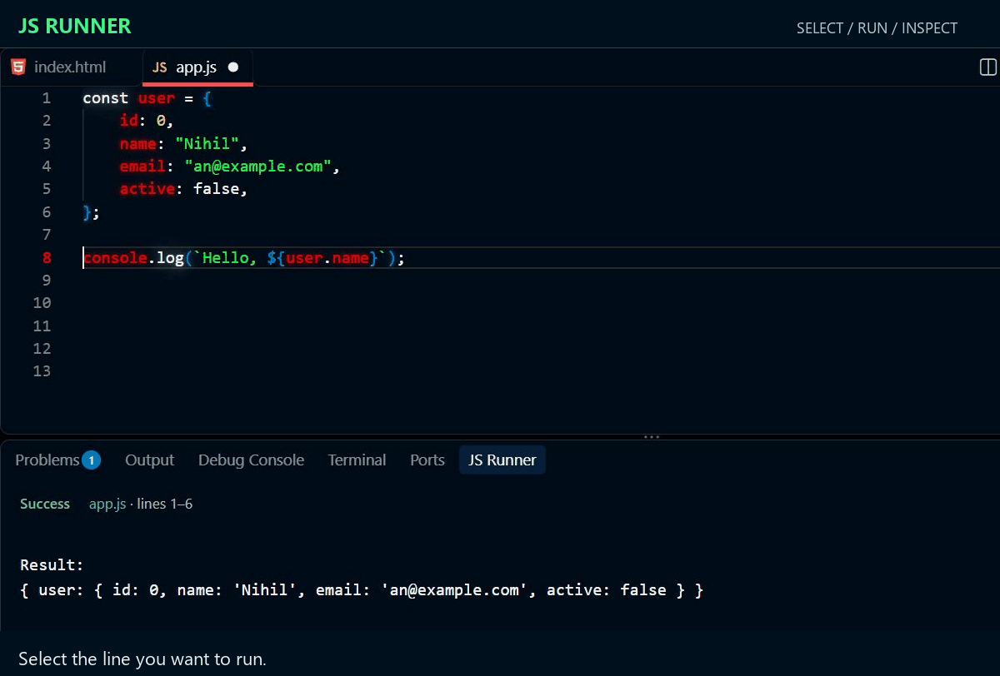
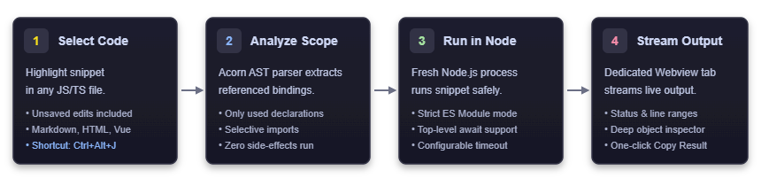

<p align="center">
  
</p>

# JS Runner

**Select JavaScript. Run it. See the result without leaving your editor.**

JS Runner gives you a JavaScript playground inside VS Code. Try an expression, inspect an object, check a helper function, or experiment with an async operation in a dedicated bottom panel. Run directly from your current selection, including unsaved edits, without creating a separate script or adding temporary logging throughout your project.

With **Pardus** as its face, JS Runner is built around a focused workflow: select the code you care about and get readable feedback close to where you work.

[Quick start](#quick-start) · [Examples](#try-it-with-real-code) · [Settings](#settings) · [Troubleshooting](#troubleshooting) · [Support](https://github.com/projectGloria/jsRunner/issues)

<p align="center">
  
</p>

*Recorded in VS Code: automatic context loading, top-level await, live console output, and results in the JS Runner panel. The demo loops every 15 seconds.*

## Why JS Runner?

- **Run just your selection.** Check a calculation or a small block without launching your entire application.
- **Keep useful context.** Automatically load supported top-level declarations and imports referenced by your selection, including their dependencies.
- **Work with unsaved edits.** The active document's current buffer supplies your selection and its local context.
- **Use top-level `await`.** Experiment with promises and asynchronous functions without writing an async wrapper yourself.
- **See logs as they arrive.** Console output and stderr stream into the panel, followed by the final result when available.
- **Inspect more than strings.** Read nested objects, arrays, circular references, and errors with causes and custom properties.
- **Start fresh every time.** Each run uses a separate Node.js process, with a configurable timeout and a Stop action.
- **Stay in the editor.** Run by keyboard, right-click menu, or panel toolbar, and copy the output with one action.

## Quick start

### Requirements

- VS Code **1.90.0 or newer**.
- Node.js **20.19 or newer**, available on `PATH` or configured with `jsRunner.nodePath`.
- A **trusted workspace**. Snippets execute with the permissions of your Node.js process.

### Install

In VS Code, open **Extensions** (`Ctrl+Shift+X` on Windows/Linux or `Cmd+Shift+X` on macOS), search for **JS Runner** by **Nihilnia**, and install it.

If you have downloaded a `.vsix` package instead, open the Extensions view's **…** menu, choose **Install from VSIX…**, and select the package.

### Your first run

1. Open a JavaScript file or create an untitled editor.
2. Paste and select the following code:

   ```javascript
   const prices = [12, 25, 8];
   prices.map(price => price * 2);
   ```

3. Press **`Ctrl+Alt+J`** on Windows/Linux or **`Cmd+Alt+J`** on macOS. You can also right-click and choose **Run with JS Runner**.
4. The **JS Runner** bottom panel opens with the result:

   ```text
   Result:
   [ 24, 50, 16 ]
   ```

The last expression supplies the result. A trailing variable declaration displays its declared bindings; a trailing function or class declaration displays the declared value. Console output appears even when the code has no final value.

## Try it with real code

### Check a function without selecting its setup

Put this in a JavaScript file, then select **only `total(100);`**:

```javascript
const taxRate = 0.18;
const discount = 5;

function total(price) {
  return price * (1 + taxRate) - discount;
}

total(100);
```

JS Runner loads the referenced function and constants from the current buffer and displays `113`. You do not need to include their declarations in the selection.

### Explore asynchronous code

Select this whole block:

```javascript
const values = await Promise.resolve([1, 2, 3]);
console.log('Loaded items:', values.length);
values.map(value => value * 2);
```

Output:

```text
Loaded items: 3

Result:
[ 2, 4, 6 ]
```

### Inspect a data transformation

Select this whole block to see the resulting objects:

```javascript
const users = [
  { name: 'Ada', active: true },
  { name: 'Linus', active: false },
  { name: 'Grace', active: true }
];

users
  .filter(user => user.active)
  .map(user => ({ ...user, label: user.name.toUpperCase() }));
```

### Use a local JavaScript module

Given a saved `format.js` file next to your current file:

```javascript
// format.js
export function label(name) {
  return `Hello, ${name}!`;
}
```

Write the following in your current JavaScript file and select **only `label('Pardus');`**:

```javascript
import { label } from './format.js';

label('Pardus');
```

JS Runner loads the supported declarations needed by `label` and displays `'Hello, Pardus!'`. Local imported files are read from disk; unsaved changes in other editors are not included.

## Commands and panel controls

| Action | How to use it |
| --- | --- |
| Run a selection | `Ctrl+Alt+J` / `Cmd+Alt+J`, right-click **Run with JS Runner**, or use the panel's Play action. |
| Stop execution | **JS Runner: Stop Execution** in the Command Palette, or the panel's Stop action while a run is active. |
| Reopen results | **JS Runner: Show Panel** in the Command Palette. |
| Copy output | **JS Runner: Copy Result** in the Command Palette, or the panel's Copy action. |

The run command appears as **Run with JS Runner** in the Command Palette. The panel displays the source filename, selected line range, and execution status. You can rerun the current selection from the panel toolbar; starting a new run cancels the previous one.

The default shortcut and editor menu are available in JavaScript, JavaScript React, TypeScript, TypeScript React, Markdown, HTML, Vue, and Svelte editors. **The selection itself must be executable JavaScript.** JS Runner does not transpile TypeScript, JSX, templates, or framework components. The Command Palette run action is available regardless of editor language.

## How automatic context loading works

JS Runner analyzes references in your selection and resolves supported declarations at the document's top level. It follows their dependencies, including supported local JavaScript imports and Node.js built-ins. Unrelated top-level statements are skipped during automatic context loading.

<p align="center">
  
</p>

There are two execution paths to keep in mind:

- **Automatic context:** Referencing a binding outside the selection loads supported declarations and relevant mutation statements, subject to the loader's static checks. Supported array updates and property assignments can be included; unrelated logging is skipped. Shared dependencies are evaluated once per run.
- **Explicit execution:** Code you select runs as written. Selecting an import statement, or calling `require()` or dynamic `import()` in the selection, uses normal Node.js module execution and can run module initialization code.

Automatic context loading is deliberately limited. Classes, destructuring declarations, getters, arbitrary initializer calls, and circular automatic imports may require you to include the relevant setup in your selection. Automatic local imports support `.js` and `.mjs` files; package imports that require full initialization should be included explicitly in the selection.

If the surrounding document cannot be parsed as JavaScript, JS Runner can still run a valid JavaScript selection on its own. A notice explains when external declarations were not loaded. This is useful for snippets inside Markdown, HTML, or a partially edited file.

## Settings

Open VS Code Settings and search for **JS Runner**, or add these values to `settings.json`:

```json
{
  "jsRunner.nodePath": "node",
  "jsRunner.timeoutMs": 5000,
  "jsRunner.inspectionDepth": 5
}
```

| Setting | Default | Purpose |
| --- | --- | --- |
| `jsRunner.nodePath` | `"node"` | Node.js executable name or absolute path. Requires Node.js 20.19 or newer, independently of the Node.js bundled with VS Code. |
| `jsRunner.timeoutMs` | `5000` | Execution deadline in milliseconds, from `100` to `300000`. Increase it for longer asynchronous work. |
| `jsRunner.inspectionDepth` | `5` | Nested object inspection depth, from `0` to `20`. Higher values show more detail. |

Streamed program output is limited to 100 KB per run, with a truncation notice when reached. Final results and errors are separately bounded. Large arrays and strings are abbreviated during inspection, and getters and custom inspection functions are not invoked to format results.

## Runtime and privacy

Every run starts in a fresh Node.js process. Variables and module state from an earlier run are not retained. Code runs in a strict async wrapper with top-level `await`, Node.js globals, and CommonJS helpers such as `require`, `__filename`, and `__dirname`. A file-backed run uses the source file's directory as its working directory.

JS Runner executes through your configured Node.js executable and has no telemetry or account requirement. The extension does not send snippets to a hosted execution service. **Your selected code and any modules it executes can access files, the network, and other resources with your user's permissions.** A separate process and timeout do not provide a security sandbox.

Browser globals such as `window` and `document` are unavailable. Function-local variables from a paused or running application are not captured. Export statements cannot be executed directly as a selection, although imported modules may contain exports. Virtual and untrusted workspaces are not supported.

## Troubleshooting

| What you see | What to check |
| --- | --- |
| Node.js cannot be started | Run `node --version` in your terminal. Install Node.js 20.19 or newer, or point `jsRunner.nodePath` to its executable. Restart VS Code after changing your system `PATH`. |
| Invalid JavaScript | Select complete JavaScript statements or expressions. Exclude Markdown fences, HTML tags, TypeScript annotations, JSX, and `export` statements. |
| A declaration cannot be loaded automatically | Include its declaration and required initialization in the selection. For package initialization, explicitly select the import too. |
| A value differs from the running application | Each run starts fresh. Automatic context reconstructs supported declarations and updates; it does not capture a live application's state. |
| Execution timed out | Check for an infinite loop or unresolved promise. Increase `jsRunner.timeoutMs` if the work legitimately needs more time. |
| Result received, but the process stopped at the deadline | The snippet produced a result while timers or other handles remained active. Clear intervals or close resources when finished. |
| The shortcut does nothing | Check Workspace Trust and keyboard shortcut conflicts. Try **Run with JS Runner** from the Command Palette with code selected. |

## Feedback and support

Found a bug or have an idea? [Open an issue](https://github.com/projectGloria/jsRunner/issues) with a small reproducible snippet, your VS Code and Node.js versions, and the output you expected. See [support guidance](SUPPORT.md) for details and [release notes](CHANGELOG.md) for the current release.

## Development

Use Node.js 20.19 or newer. Clone the repository, then run:

```sh
npm ci
npm run check
npm test
npm run test:integration
npm run package
```

`npm test` builds the extension and runs the Node.js tests. Integration tests use a local VS Code installation when available, or download a test copy. Press **F5** in VS Code to launch the Extension Development Host. Packaging runs type checking and builds the runtime before creating a `.vsix` file.

## License

[MIT](LICENSE) · Nihilnia / projectGloria
